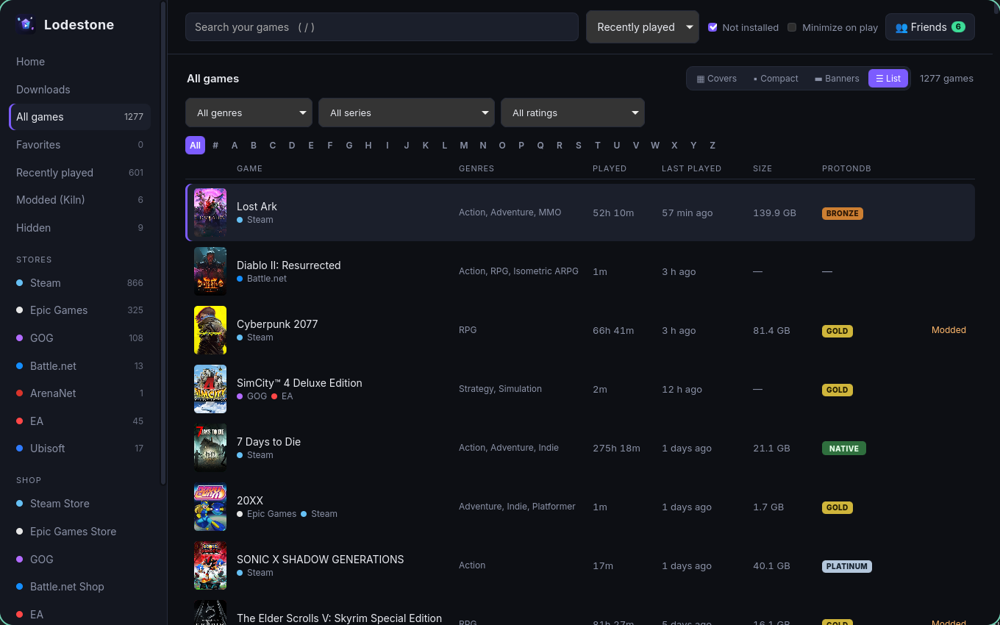

# Lodestone

One library for every game you own on Linux. On Windows I used GOG Galaxy, which I found awesome; Linux had
nothing like it that I could find, so I built Lodestone: every store in one place, installed or not.
Epic, GOG, Battle.net, EA and Ubisoft games run through Proton (via umu-launcher), so they don't go through
the Steam client. Steam itself is still needed for your Steam games and Steam features like friends.



> [!NOTE]
> Lodestone is a beta (0.2, the Emulation Update), built with an AI coding assistant and reviewed and tested by me.
> Read [How Lodestone is built](#how-lodestone-is-built) and [Security and privacy](#security-and-privacy)
> before you sign in to anything.

| Store | What Lodestone does |
|---|---|
| Steam (native or Flatpak) | Your whole library, installed or not. Installs, updates and uninstalls in the background, and plays through Steam with its window kept out of the way |
| Epic Games, GOG | Its own sign-in: install, update, uninstall and play through Proton, no Heroic needed |
| Battle.net, EA app, Ubisoft Connect | Sets each one up on Proton (or uses the one you installed with Lutris or Steam), lists what you own, and plays through it. Battle.net installs run in the background; World of Warcraft can start directly |
| Guild Wars 2 | Installs and runs it on Proton |
| Heroic, Lutris | Games you installed with them (including Amazon through Heroic) show up and play through them |
| Emulators | Your ROMs in EmuDeck's folder layout, one library per system, played with the emulator you choose (installed from Flathub in one click if it's missing). Names, box art and achievements from RetroAchievements |
| Minecraft | Your ATLauncher instances, with a hub for mods, resource packs and shaders (in development) |
| Anything else | **+ Add game**: a native game or script, or a Windows `.exe` run with Proton |

Plus a Downloads tab, play time from Steam, Epic, Lutris and Heroic, game details and news, Steam and
RetroAchievements achievements, ProtonDB ratings, artwork editing, MangoHud, Steam friends, and modding
through [Kiln](#mods-with-kiln).

Every launch runs detached, with its output in `~/.local/share/lodestone/logs/<game>.log`
(⋯ → View launch log). Lodestone tracks running games from the process list, which is also how it counts
play time.

## Install

| Where | How |
|---|---|
| Arch Linux and friends (AUR) | `yay -S lodestone` (builds from source) or `yay -S lodestone-bin` (prebuilt) |
| Most other distributions | the `.AppImage` from the [latest release](https://github.com/daigonstar/lodestone/releases/latest): make it executable and run it |
| Debian, Ubuntu, Mint, Pop!_OS | the `.deb` from the latest release: `sudo apt install ./Lodestone_*_amd64.deb` |
| Flatpak (any distribution, Steam Deck) | the `.flatpak` from the latest release: `flatpak install --user lodestone-*.flatpak` |

The native packages (AUR, AppImage, .deb) have every feature. The Flatpak runs games on the host through
`flatpak-spawn`, so it needs host access.

Making a release yourself? See [RELEASING.md](RELEASING.md).

## How Lodestone is built

I'm an IT Support Engineer with strong server and cloud experience, not a full-time application developer. I built Lodestone because I kept
hitting gaps in Linux gaming: games spread over half a dozen launchers, Battle.net and EA needing Lutris
scripts, no one place to see what I own or have played. On Windows I used GOG Galaxy, which I found awesome.
Linux had nothing like that I could find. Like others, I was aggressively against AI until I realised its
potential. Can AI-written code be a security risk? Yes, like any code, which is why I review every change,
test it myself, and publish all of it here for anyone to check.
Below is an honest and accurate account of how the app is made, what it does and what it talks to.

> [!IMPORTANT]
> If you have any concerns, please read on, and audit the code yourself.

**Lodestone is written with an AI coding assistant (Anthropic's Claude).** Every commit says so in its
`Co-Authored-By` line. I decide what gets built, review the changes, and test them on my own machine
(Arch Linux, Hyprland, AMD) before they're released. I'm not hiding that, and I'd rather you know up front
than find it in the git history.

What that means in practice:

- **It's a beta (0.2.x).** Steam, Epic, GOG, Battle.net (Diablo II: Resurrected) and
  the library, play time and downloads are what I use daily. EA sign-in, Ubisoft, some World of Warcraft
  versions and the Minecraft hub have had less real-world use, and emulation and achievements are new in
  0.2. Please report what breaks.
- **It's maintained in my spare time**, around a full-time job and a young family. I'll fix what I can,
  but replies may take a few days. Pull requests and clear bug reports (with the launch log from
  ⋯ → View launch log) help enormously.
- **The code is all here** under the GPL, and the release files are built by GitHub Actions from the tagged
  source, so you can check what you're running.

## Security and privacy

Lodestone signs in to stores for you and starts other programs, so here is exactly what it does with
that access.

**No telemetry.** Lodestone has no analytics, crash reporting or tracking, and no server of its own. It
only talks to the stores and services below, when you use a feature that needs them.

**Where your sign-ins are kept.** Everything stays on your PC, readable only by your user account
(folders `700`, files `600`):

| What | Where |
|---|---|
| Steam Web API, SteamGridDB and CurseForge keys, RetroAchievements username and Web API key (all optional) | `~/.config/lodestone/settings.json` |
| EA and Ubisoft sessions | `~/.config/lodestone/ea.json`, `ubisoft.json` |
| Epic sign-in (kept by legendary) | `~/.local/share/lodestone/legendary/` |
| GOG sign-in (kept by gogdl) | `~/.local/share/lodestone/gog/` |
| Cookies from the sign-in and store windows | `~/.local/share/dev.lodestone.launcher/` (WebKit's data folder) |

You sign in on each store's own login page, in a Lodestone window. Lodestone never reads or stores your
passwords, only the session tokens the stores hand back. Battle.net keeps its own sign-in inside its
Wine prefix; Lodestone only turns its "keep me logged in" option back on. Signing out in
**Accounts** deletes the stored session.

**Who Lodestone talks to.** The complete list, every address with what it's for, is in
[network-hosts.txt](network-hosts.txt). In short:

- **Stores, for your library and downloads:** Steam (`api.steampowered.com`, `store.steampowered.com`),
  Epic, GOG, EA and Ubisoft, using the same web services their own apps use. Battle.net's download service
  runs locally on your PC and is only reached on `127.0.0.1`.
- **Game information and artwork:** ProtonDB, Wikipedia and Wikidata, GOG's public catalog, SteamGridDB
  (with your key), Modrinth and CurseForge (Minecraft).
- **Steam achievements (with your Steam Web API key):** a game's achievement list and your unlocks from
  `api.steampowered.com`, sending your key, your Steam ID and the game's app ID, plus how rare each one is
  (public, no key). The list is cached for a week in `~/.local/share/lodestone/achievements/`. Your Steam
  profile's *Game details* must be public for Steam to share your unlocks.
- **RetroAchievements (only if you add your RA username and Web API key):** `retroachievements.org` for
  each system's game list, a game's details and your achievement progress, and `media.retroachievements.org`
  for box art and badges. Only your username and key are sent. Your ROMs are identified on your PC by
  fingerprint (an MD5 hash, the same one RetroAchievements uses); the ROM files and their names never
  leave your PC. Game lists, fingerprints and details are cached in `~/.local/share/lodestone/retroachievements/`.
- **libretro thumbnails (for ROMs with no other box art):** the list of each system's box art from
  libretro's official GitHub repositories (`api.github.com`, two requests per system, refreshed weekly and
  cached in `~/.local/share/lodestone/libretro-thumbnails/`), and the images from `raw.githubusercontent.com`.
  ROMs are matched on your PC; only the system's name is sent. No key or account.
- **Kiln (the mod manager plug-in, only when you use it):** Nexus Mods (`api.nexusmods.com`, with your own
  Nexus API key, which Kiln keeps in `~/.config/kiln/settings.json`, `600`; `www.nexusmods.com` pages in Kiln's
  own window, where you sign in yourself), the official downloads of the mod loaders a game needs (GitHub
  releases such as SMAPI, BepInEx, UE4SS, and Microsoft's Visual C++ runtime installer from `aka.ms`), and
  SMAPI's mod database (`smapi.io`) to find a Stardew mod's Nexus page. Kiln has no telemetry. Its optional
  AI helper talks only to an Ollama on your own PC. Every address is in [network-hosts.txt](network-hosts.txt).
- **Tools Lodestone sets up for you:** the official GitHub releases of umu-launcher (runs Proton),
  legendary (Epic), gogdl (GOG) and MangoHud, and the official installers of Battle.net, the EA app,
  Ubisoft Connect and Guild Wars 2. These are downloaded over HTTPS from their publishers. The GitHub tools are
  checked against the SHA-256 checksum GitHub publishes for each release file and refused if they don't
  match; the store installers have no published checksum, so for those you're trusting the publisher.
  Minecraft mods are checked against Modrinth's and CurseForge's checksums.

**Plug-ins and test builds.** The Plug-ins page asks `api.github.com` for each plug-in's releases when you
open it, and downloads one only when you press the button, checking it against GitHub's published SHA-256.
Releases marked as pre-release (test builds, which are unfinished) are skipped unless you turn on *Also offer test
builds* on that page. It's off by default and applies to every plug-in, third-party ones included.

**Unofficial APIs.** Steam's Web API is public, but Epic, GOG, EA, Ubisoft and Battle.net are reached
through the web services and local programs their own apps use, not through public developer APIs. This
is the same approach as Heroic, legendary and Lutris. It works today but isn't something these companies
promise to keep working, and using it is your call.

**Files Lodestone changes outside its own folders.** These are only changed when you use the feature
named, and are listed so nothing is a surprise:

- **Steam (background installs):** with *Keep Steam in the background* on, Lodestone edits Steam's
  `appmanifest_*.acf` files to queue installs, updates and uninstalls, then restarts Steam quietly.
- **Battle.net:** `Battle.net.config`, to keep you signed in and to start minimized without its window
  coming back after games.
- **World of Warcraft:** *Play and choose a realm* removes the remembered realm from `WTF/Config.wtf`.
- **MangoHud:** `~/.config/MangoHud/MangoHud.conf` (the first save keeps your original as
  `MangoHud.conf.bak`), and two Vulkan layer files in `~/.local/share/vulkan/implicit_layer.d/` if
  Lodestone sets MangoHud up itself.
- **Emulators (when you press Install in a system's library):** the emulator's official Flatpak from
  Flathub, installed for your user (`flatpak install --user`, adding the Flathub remote for your user if
  it's missing), and for RetroArch the chosen core from libretro's official build server into
  `~/.var/app/org.libretro.RetroArch/config/retroarch/cores/`, checked against libretro's published CRC32.
  That catches a broken download, not a deliberately altered one (libretro publishes no stronger
  checksum), so cores rely on HTTPS and libretro's server; the Flatpak RetroArch runs them in its sandbox.
  Your emulator choice per system is saved in `settings.json`. Lodestone never downloads games or BIOS files.
  Unless you tick *Add to my app menu* when installing, the emulator is hidden from your desktop's app menu:
  Lodestone copies Flatpak's menu entry into `~/.local/share/applications/` with `NoDisplay=true` added and
  a comment marking it as Lodestone's. Ticking *Show in my app menu* in the system's library deletes that copy;
  Lodestone never touches menu entries it didn't write.
- **ROM folders:** *Create folders* in Settings → Emulation makes a `roms` folder with one empty folder per
  system in the folder you choose (`~/Emulation` if you leave it empty). Existing folders and files are left
  as they are.
- **Minecraft (ATLauncher):** the instance's `instance.json` when you add or remove mods (backed up as
  `instance.json.lodestone-backup` first).
- **Kiln (when you use it):** it makes your mods appear in a game's folder (hardlinks, taken out again on
  *Purge*, with the files it replaced kept), writes the game's plugin list (`plugins.txt`) in its Proton
  prefix and some game `.ini` settings, and sets Steam's launch options for script extenders in
  `localconfig.vdf` (only while Steam is closed, with a `.kiln-<time>.bak` backup first). *Make Kiln the
  nxm handler* adds `kiln.desktop` to your app menu and sets the `nxm://` link handler, remembering the
  previous one so it can be restored. Kiln's own files are in `~/.config/kiln/` and `~/.local/share/kiln/`.
  Not all of this has been re-checked for this README: Kiln's own README lists what each feature does.
- **Wine prefixes:** Battle.net, EA, Ubisoft and games run in prefixes under
  `~/.local/share/lodestone/prefixes/`. If Battle.net, EA or Ubisoft is already installed through Lutris
  or Steam, Lodestone uses that prefix instead, and Proton may update it.

**The Flatpak** runs games, Steam and Proton on your system rather than inside its sandbox, so it has
host access (`--filesystem=host`, `--talk-name=org.freedesktop.Flatpak`). Its protection is the same as
the native packages', not stronger.

**Kept honest automatically.** These promises aren't just words:

- **Every push is checked.** A GitHub Actions check ([checks.yml](.github/workflows/checks.yml)) fails if the code
  mentions any web address that isn't in [network-hosts.txt](network-hosts.txt). A new destination can't
  slip in quietly: it has to be added to that file, in public, where anyone can see it in the commit.
- **Dependencies are audited.** The same check runs `cargo audit` against the RustSec database of
  known-vulnerable Rust libraries, and Dependabot suggests updates monthly.
- **The interface is locked down.** A strict content security policy means only Lodestone's own script
  files can run in its window, and store pages, sign-ins and news open in separate windows with no access
  to the app.
- **Reviews are published.** Each security review, every finding and fix included, is in
  [docs/security-reviews](docs/security-reviews/) ([SECURITY.md](SECURITY.md) has the list).
- **The rules are written down.** [AGENTS.md](AGENTS.md) sets out what Lodestone will never do: no
  telemetry, no hidden network calls, no back doors or obfuscated code, sign-in data never leaves your
  PC. AI coding tools read that file as the project's rules, and so can you. It's public on purpose,
  not a hidden instruction.

**Found a security problem?** Please don't open a public issue. Use GitHub's private
[security advisory](https://github.com/daigonstar/lodestone/security/advisories/new) form instead.

## Other apps I build

Other than my Hyprdots project (which was started by hand but accelerated with the assistance of Claude late this year), I have been
using Claude a lot. I do not see this personally as an issue, as I always look at these things from a security and privacy first perspective.
That's the reason I moved to Linux in the first place.
Other apps, like my Kiln Mod Manager, which Lodestone also communicates with to tag and launch modded games, have been built the same way.
I do learn from this, as I like to review and test changes myself. I also try to test on multiple systems, not just my own.

With this in mind, if you feel these projects are beneficial, please do give them a go.

## Steam: install, uninstall, Workshop

- Turn on **Not installed** to see every game you own on Steam (read offline from Steam's own `appinfo.vdf`
  cache and `localconfig.vdf`, no API key).
- **Steam stays in the background.** Lodestone starts Steam silently (tray only) and installs, updates and
  uninstalls Steam games itself, with progress in Lodestone's downloads panel, including updates Steam starts on its own.
  Steam only reads its app manifests at startup, so Lodestone stops Steam for a few seconds, writes the change
  (a new manifest marked "update required" to install, a cleared update schedule to update now, the game's files
  removed to uninstall; the Proton prefix with saves is kept) and restarts it with `-silent`. Progress comes from
  Steam's `logs/content_log.txt` and the manifests. The store browser's **Install** buttons work the same way.
  While a Steam game is running Lodestone never restarts Steam and uses Steam's own dialogs instead.
  Turn it off in Settings → Steam to always use Steam's dialogs.
- Games with Workshop support get a **Workshop** button: your installed items (titles and previews from Steam's
  public API), **Browse Workshop** in a Lodestone window (sign in to Steam Community once to subscribe), or open it in Steam.

## Home, details and artwork

- **Home** dashboard: what's installed, pending updates (with each game's latest patch notes and an Update
  button), games you played recently, and a news feed from your games (Steam announcements, filterable to
  patch notes). News and patch notes open in a Lodestone window.
- Selecting a game shows its **description, developer, publisher, release date, Metacritic score, features,
  screenshots and latest news** under the header. Data comes from Steam's public store API. Epic, GOG and
  other games use the Steam game with the same title, or the one you pick.
- **ProtonDB ratings** (Platinum to Borked) show on covers, in the list view and in the details panel, which links
  to the game's ProtonDB page. Steam games with a Linux version show **Native** instead. Ratings are cached for a day.
- **Library layouts:** covers, compact covers, wide banners, or a list with genres, time played, last played and size.
- **Sorting** is remembered per library: recently played, A–Z, Z–A, most played, favorites first, size, ProtonDB
  rating, store, or (in a system's library) RetroAchievements matches first. Sidebar sections (Stores, Systems,
  Shop) fold away by clicking their heading; a folded section still shows the library you're in.
- **Edit details & artwork** (⋯ menu or the details panel): change the title, genres or series, pick which Steam
  game it is, and choose covers and banners from Steam's store art or SteamGridDB. SteamGridDB needs a free
  API key, set in Settings → Artwork. Chosen images are saved in `~/.local/share/lodestone/art`; your edits are kept in `meta.json`.
- **Missing artwork:** Lodestone checks which covers don't exist and lists those games. **Find artwork** fills in
  what it can. Steam games with no portrait cover get one built from their wide store header.
- Epic's library also lists Unreal Engine assets and tools you own. Lodestone only shows the ones Epic files under games.

## Emulation and achievements

- **ROM libraries.** Lodestone reads EmuDeck's layout (`Emulation/roms/<system>`, found in your home folder
  and on mounted drives, RetroDECK's folder too) and lists each system that has games under **Systems** in
  the sidebar. ROMs somewhere else? In **Settings → Emulation**, choose the Emulation folder, its `roms`
  folder, or any folder with one folder per system (`snes`, `gba`, `psx`…). Starting from scratch,
  **Create folders** makes that layout for you, with a folder for every system Lodestone knows. Multi-disc games (`.m3u`, `.cue`) show once. ES-DE's `gamelist.xml` names and downloaded covers
  are used when they're there. ROMs stay out of **All games**.
- **Choosing the emulator.** A system's library has a **Plays with** list, built from EmuDeck's (or ES-DE's)
  launch commands: RetroArch cores and standalone emulators. Lodestone finds emulators installed as Flatpaks,
  on your PATH or as AppImages in `~/Applications`.
- **One-click installs.** If the chosen emulator is missing, **Install** adds it from Flathub for your user in
  the background (follow it in Downloads), with the RetroArch core from libretro's build server when needed.
  **Add to my app menu** is off by default, since you start them from Lodestone; a system's library can show
  or hide an installed Flatpak emulator later. Lodestone never downloads games or BIOS files.
- **RetroAchievements.** Add your RA username and Web API key (from your RetroAchievements control panel) in
  Settings. Lodestone fingerprints your ROMs on your PC the same way RetroAchievements does, so the right
  version of a game matches; matched ROMs get RetroAchievements' names and box art, and a game's details
  show its achievements and your progress (hardcore unlocks are outlined).
- **Box art backup.** ROMs that RetroAchievements and ES-DE have no art for get box art from libretro's
  thumbnail collection, the one RetroArch uses. Covers are shown whole instead of cropped.
- **Steam achievements.** With your Steam Web API key set, a Steam game's details show its achievements:
  earned ones first, with when you earned them and how many players have each one (rare ones you've earned
  are outlined). Your Steam profile's *Game details* must be public. GOG and Epic achievements aren't
  supported: GOG only shares them through its Galaxy service, and Epic has no public API for them.

## Friends

- **👥 Friends** (top bar) opens your friends from Steam and Epic, with Steam friends grouped by in game, online
  and offline. The top-bar count shows how many are online. If a friend is playing a game in your library, click it to open that game.
  Profiles and **Steam chat** open in a Lodestone window (sign in to Steam Community once).
- The **Home** dashboard shows who's playing now. A game's details list **friends who own it** and their hours,
  and the heading changes to **Friends playing now** while any of them are playing it.
- **Steam** uses your Web API key: friends list, status, current game, and each friend's library (cached for a day).
  Your Friends List must be public in Steam's privacy settings. **Epic** uses Lodestone's Epic sign-in and lists names only,
  because Epic shares online status only over its chat connection. GOG and Battle.net have no public friends API.

## Minecraft hub

> **In active development.** The hub works with ATLauncher today; Prism Launcher support is early, and other
> launchers (including the official one) aren't supported yet.

Click **Minecraft** in the sidebar, or start straight into it with `lodestone --view minecraft`
(handy as its own desktop shortcut). ATLauncher / Prism still handle Microsoft sign-in and running the game; Lodestone manages content:

- **Mods / Resource packs / Shaders**, per instance, matched to its Minecraft version and loader.
- **Installed**: files are identified on Modrinth by hash (name, icon, version). Enable/disable (ATLauncher's
  `disabledmods/` or Prism's `.disabled`), move to trash, **Check for updates**, update one or all.
- **Browse**: search Modrinth (no key) or CurseForge (free personal key in ⚙ Settings) and install with required
  dependencies. Downloads are checksum-verified.
- ATLauncher instances: new and removed files are also written to `instance.json` (backup kept as
  `instance.json.lodestone-backup`), so close ATLauncher while changing mods.

## Mods with Kiln

Modding goes through **Kiln**, a mod manager that is part of this repository (`kiln/`) and installed as a plug-in from Lodestone's own GitHub releases (tagged `kiln-v<version>`). When Kiln is installed,
Lodestone shows which games it can mod (the **Modded (Kiln)** view and a *Modded* tag), and **Play modded** starts
a game through Kiln's Guarded Play, which checks that mods are deployed and loaders are set up first
(⚙ Settings → Mods; the ▾ next to Play also offers *Play without mods*). Without Kiln, everything else in
Lodestone works as usual and these options don't appear.

Kiln is a *companion plug-in* (⚙ Settings → Manage plug-ins): you can turn it off there, and Lodestone then
stops asking Kiln anything. Lodestone shares nothing with Kiln; it only runs Kiln's command line
(`kiln --games`, `--status`, `--game`, `--play`, `--play-vanilla`). Kiln can be installed from the Plug-ins page (official release from its GitHub, checksum checked). It runs on your system's Python, so it needs PySide6 and requests installed (Arch: `pacman -S pyside6 python-requests qt6-webengine libarchive`); Lodestone tells you if they're missing. Kiln only runs on Linux so far, so on
Windows the plug-in shows "not installed" until Kiln has a Windows build. This hasn't been tested on Windows.

## Run

```bash
cd src-tauri && cargo tauri dev        # from the repo root: cargo tauri dev
cargo tauri build                      # AppImage + .deb in src-tauri/target/release/bundle
```

### Flatpak

```bash
packaging/flatpak/build.sh             # installs io.github.daigonstar.Lodestone and writes packaging/flatpak/lodestone.flatpak
```

Needs `flatpak install --user flathub org.flatpak.Builder org.gnome.Sdk//51 org.freedesktop.Sdk.Extension.rust-stable//26.08`. The build is offline like Flathub's: crates come from `packaging/flatpak/cargo-sources.json` (rebuilt from `Cargo.lock` by `cargo-sources.py`).
The Flatpak uses the same settings, library data and sign-ins as a native install. Games, Steam, umu-run and
store clients still run on the host: Lodestone starts them with `flatpak-spawn --host` and watches the host's
process list, so the app has host access (`--talk-name=org.freedesktop.Flatpak`, `--filesystem=host`).

See what's detected without the UI:

```bash
cd src-tauri && cargo test print_library -- --ignored --nocapture
```

## Epic Games and GOG without Heroic

**👤 Accounts → Sign in** opens the store's official sign-in page in a Lodestone window; Lodestone catches the
sign-in code and hands it to its own copies of [legendary](https://github.com/derrod/legendary) (Epic) and
[gogdl](https://github.com/Heroic-Games-Launcher/heroic-gogdl) (GOG), kept in `~/.local/share/lodestone/tools`.
(Or **Use Heroic's sign-in** to move Heroic's session over; Heroic then has to sign in again.)

- Your whole library shows up (Rescan also refreshes it from the stores).
- **Install** downloads with progress at the bottom of the window, into `~/Games/Epic` / `~/Games/GOG`
  (change in ⚙ Settings → Games). Cancel and re-install resumes.
- Games launch through Proton (umu) in their own prefix, with GE-Proton's per-store fixes.
- Before a GOG game first starts, Lodestone does what GOG Galaxy does after an install: runs the game's
  `goggame-<id>.script` (registry keys, save folders, first-run files, small fix-up tools) and puts GOG's
  support files in the game folder. Older games such as SimCity 4 don't start without this.
- **Uninstall**: Epic deletes the files (legendary); GOG moves the folder to the trash.
- When Heroic is still installed, a game installed there keeps launching through Heroic until you install it via Lodestone.

## Proton without Steam

Lodestone keeps its own copy of [umu-launcher](https://github.com/Open-Wine-Components/umu-launcher)
in `~/.local/share/lodestone/tools` (⚙ Settings → Compatibility → Set up / Update) and runs Windows programs
through Proton in per-app prefixes under `~/.local/share/lodestone/prefixes/`. It uses the newest GE-Proton
it finds (ProtonUp-Qt / Steam folders), or one you pick, or downloads the latest GE-Proton automatically.

## Battle.net and Guild Wars 2

Open **Battle.net** in the sidebar → **Set up Battle.net**: Lodestone downloads Blizzard's official installer and
installs it into its own Proton prefix (with GE-Proton's Battle.net fixes via `STORE=battlenet`). Sign in and install
games in Battle.net; after a Rescan each game (found via its `.build.info`) launches from Lodestone with
`Battle.net.exe --exec="launch <code>"`. **ArenaNet → Install Guild Wars 2** does the same with ArenaNet's installer.

- **Silent Blizzard installs:** Install asks Battle.net's download service (the Agent, its local web API) to
  install the game, with Battle.net started in its tray mode so its window stays hidden; progress shows in the
  downloads panel. The Agent's session token is read from its own log in Lodestone's prefix and only sent to
  the Agent on this PC. If that fails, Battle.net opens on the game's page instead.
- Lodestone keeps Battle.net's "Keep me logged in" on, so it doesn't ask for your password every start.

## EA and Ubisoft

**EA → Set up EA app** and **Ubisoft → Set up Ubisoft Connect** install each launcher into its own Proton prefix.
Games you install there show up after a Rescan: EA games start through the EA app, Ubisoft games through
Ubisoft Connect (`uplay://launch/<id>/0`).

Both launchers keep your library encrypted on disk, so to list games you own but haven't installed, **👤 Accounts →
Sign in** for EA and Ubisoft opens their official sign-in page in a Lodestone window, and Lodestone reads your
library from the same web APIs their sites use (sessions kept in `~/.config/lodestone/{ea,ubisoft}.json`, mode 600).
Install on an EA game opens the EA app and starts the download; on a Ubisoft game it opens Ubisoft Connect
(Ubisoft's API doesn't give the id its install links need). The EA app's Windows folder link (`EA Desktop\EA Desktop`),
which Wine leaves broken, is replaced with a real link to the current version.

**+ Add game → "Windows game: run it with Proton"** runs any `.exe` in its own prefix.

### Older notes

Install them through Lutris (search "Battle.net" / "Guild Wars 2" in Lutris and use the community installer).
They appear here automatically, tagged as Battle.net / ArenaNet. Or add any Wine game by hand with
**+ Add game**, e.g. `umu-run "/home/you/Games/gw2/Gw2-64.exe"`.

## Keys

`/` search · arrows move · `Enter` play · `F` favorite · `Ctrl+R` rescan

## License

Lodestone is free software under the GNU General Public License, version 3 or later. See [LICENSE](LICENSE).
