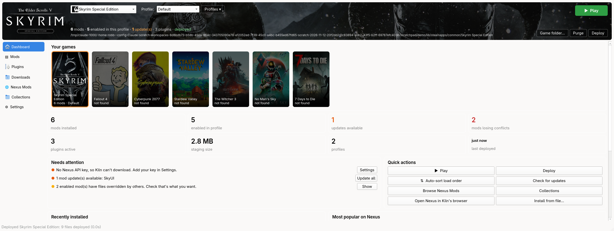
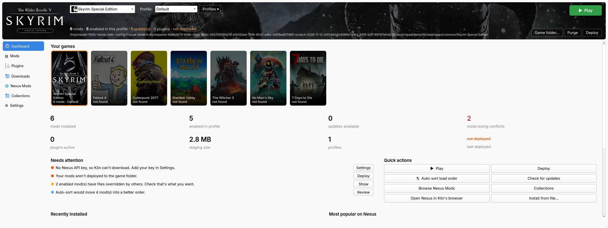
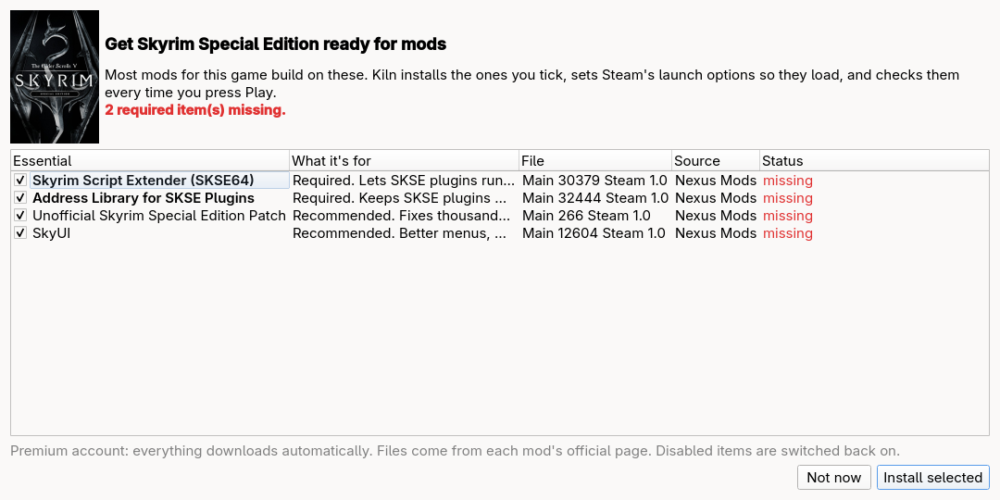

# Kiln

A Linux mod manager in the style of Vortex, for Steam games running natively or under Proton.



- **Dashboard:** box art for all your games (click one to switch), plus tiles for:
  - mods, enabled mods, updates, losing conflicts, plugins, staging size, profiles and last deploy.

  It also has a "Needs attention" list with one-click fixes (no API key, not deployed, updates, missing masters, conflicts, a better sort order), quick actions, your recent installs and the most popular mods on Nexus.
- **Profiles:** different mod setups for the same game, picked from the banner. Each profile keeps its own mods, enabled state, mod order and plugin load order, and switching redeploys the game. The Mods page only shows the mods in the current profile (installed into it or added to it). Files are stored once and shared, so nothing is downloaded twice: "Show all downloaded" lists mods from your other profiles in italics, and ticking one adds it to this profile. Collections reuse mods you already downloaded for another profile. "Remove from this profile" keeps the files; deleting a mod warns if other profiles use it. You can create empty or duplicated profiles, rename them and delete them.
- **Auto-sort:** one click orders mods and plugins the way modding guides and LOOT recommend:
  - frameworks and fixes first;
  - broad texture overhauls before targeted ones;
  - then gameplay, characters, quests, audio and presets;
  - compatibility patches and your own tweaks last.

  A mod that needs another mod's plugins always loads after it. "Make this mod win" choices are saved as rules that auto-sort keeps. You see a preview of every move before it's applied. A Settings option sorts automatically after each install.



- **Essentials setup:** on first run, Kiln lists the supported games you have installed and what each needs before modding. Opening a game for the first time offers to set it up, and "Set up essentials…" on the dashboard, or the banner's "Install essentials" button (red when a required one is missing from the current profile), does it any time. Essentials already downloaded for another profile are reused, not downloaded again. Kiln shows the main file it will install from each mod's official page and installs the ones you tick (automatically on Premium, one click per file on a free account). It then sets Steam's launch options so they load.

  | Game | Required | Recommended |
  |---|---|---|
  | Skyrim SE | SKSE64, Address Library | Unofficial Patch, SkyUI |
  | Fallout 4 | F4SE, Address Library | Unofficial Patch, Mod Configuration Menu |
  | Cyberpunk 2077 | Cyber Engine Tweaks, RED4ext, redscript | ArchiveXL, TweakXL, Codeware |
  | Stardew Valley | SMAPI (from its official GitHub release) | Content Patcher, Generic Mod Config Menu |

  Script extenders' loader and DLL files go next to the game's exe; everything else goes into `Data`.

  
- **Guarded Play:** before launching, Kiln checks everything that stops mods loading and offers one-click fixes:
  - the deployment is intact (Steam updates and "Verify integrity" can remove files);
  - the loaders your mods need are installed: CET, RED4ext and redscript for Cyberpunk, SMAPI for Stardew, SKSE for Skyrim, F4SE for Fallout 4. Kiln installs SMAPI itself from its official release;
  - Steam's launch options load them, using Proton DLL overrides or the SMAPI/script-extender wrapper. Kiln edits Steam's config while Steam is closed and keeps a backup;
  - no game files are still links into another mod manager's folder.

  After launch, Kiln reads each loader's log and reports "✔ modded" or "✖ didn't start", in the banner and as a desktop notification. In Cyberpunk, a small CET notice in the game's corner lists your active mods; disable the "Kiln in-game notice" mod to hide it. Changes made while the game runs are deployed when it closes.
- **Troubleshoot (Mod Doctor):** a page that finds what makes a game crash or a mod not work, explains each problem in plain English (what's wrong, why it matters, how to fix it yourself), and has a button for each fix. "Fix everything" applies the safe fixes in one go after showing exactly what it will do. It checks:
  - SKSE plugins against your exact Skyrim version, using SKSE's own rules (read from each DLL), so it knows which ones SKSE will refuse before you launch. Plugins that find game code by byte patterns instead are flagged when they're older than your game (the cause of "[ERROR] Unknown pattern" boxes). It also checks that SKSE matches the game and that Address Library covers it. "Find a version that works" looks through the mod's Nexus files for one that suits your game version;
  - the same mod installed twice (e.g. by two collections) where the old copy wins, and two different mods shipping the same plugin DLL (it keeps the newest build);
  - missing, switched-off and misordered masters, and the 254-plugin limit;
  - mods that installed nothing, or sit one folder too deep;
  - deployment, mod loaders and Steam launch options;
  - tools a mod needs you to run (FNIS, BodySlide) and outdated mods with modern replacements (DAR → OAR);
  - the Microsoft C++ runtime in the game's Proton folder: many games install the 2016 one, and DLL mods built since mid-2024 crash with it ("fatal error occurred while loading plugin", error 998). "Update it" downloads Microsoft's Visual C++ Redistributable and installs it into that Proton folder with the game's own Proton;
  - requirements from each mod's Nexus page that this profile lacks (FormList Manipulator → powerofthree's Tweaks, Legacy of the Dragonborn → PapyrusUtil…). Noise is filtered: optional, VR-only and edition-specific entries, "INI file" add-ons that don't count as the mod, modern replacements (Pandora for Nemesis/FNIS, OAR for DAR), and patches listing the mods they patch (the missing-masters check covers those). A requirement you've already downloaded is added to the profile with one click (the copy that works on your game version); others install with the file made for your version. Cached for a week;
  - logs from your last session: Skyrim crash reports (Crash Logger, Trainwreck, .NET Script Framework) are read to name the DLL, mod, model and plugins involved; also SKSE's load errors, SMAPI's skipped mods and errors, and redscript compile errors.

  The **Logs** tab reads every log your last launch wrote (the script extender's own log and its loader, the Engine Fixes preloader, each SKSE plugin's log, crash reports) and translates them into plain English, with the original lines underneath. It starts with a short story of the last launch ("Skyrim closed by itself while starting up… inside Behavior Data Injector"), catches silent failures (a log that just stops because a plugin crashed the game, plugins that log errors and carry on), and leaves out harmless noise like "trampoline alloc failed". Without a crash logger it suggests installing one.
  Play warns before launching into a likely crash, and when a game closes after crashing, Kiln opens Troubleshoot with what it found. The Dashboard shows the overall verdict. Fixes wait while downloads or installs are still running.
- **Game versions:** the banner shows which version of the game you have ("Game 1.7.104 ▾"). Many mods and collections are made for an older version (for Skyrim, most target 1.6.1170), so Kiln can switch: it shows Steam's own `download_depot` commands for that version (only ones checked against several modding guides), copies them for you and watches Steam download them, then swaps the files into the game folder. Your mods are taken out and put back around the swap, the files it replaces are kept so you can switch back any time, and it can stop Steam from updating the game while you're on an older version. Currently Skyrim 1.6.1170.
- **Essentials that follow the game version:** Kiln notices when the script extender or Address Library is made for a different game version than the one installed (after a Steam update or a version switch). The banner button turns into "Fix essentials", the essentials window marks them "for another game version: swap", and Kiln asks once whether to swap in the right build, picked from the mod's Nexus files with older ones included. Choose "Always do this automatically" (or set it in Settings → Game versions) and it swaps them without asking.
- **Gentle on Nexus:** requests are spaced out; when Nexus says "too many requests" (HTTP 429) Kiln waits as long as it asks (or backs off) and retries in the background instead of failing; mod file lists are remembered for 10 minutes; "Check for updates" asks for every mod's last-updated date in bulk (25 per request) and only fetches file lists for mods changed since you installed them (about 25 requests for 567 mods instead of 567).
- **Faster Skyrim start-up under Proton:** Skyrim reads an optional `Data\\<plugin>.ini` once per setting for every plugin, and under Wine each look-up of a missing file scans the whole Data folder. With a few hundred plugins that's minutes before the window even opens. Kiln deploys an empty `<plugin>.ini` for every plugin without one (a real one from a mod always wins; Kiln removes its own when the plugin goes, and on purge). Measured with 414 plugins: 3 min 23 s → 1 min 51 s to the main menu. The Logs tab shows how long the last start-up took (from Engine Fixes).
- **Saves, per profile:** the Saves page lists your saves with their screenshot, character, level, location, time played and date (read from the save files), filtered by character, and warns when a save was made with mods its profile doesn't load (the usual way saves break). "Give each profile its own saves" points the game at Saves\\<profile>\\ (via sLocalSavePath in the game's ini, rewritten on every profile switch and before launch), optionally moving your existing saves into the current profile; renaming a profile renames its folder. Copy or move saves between profiles, delete them (to the Trash, co-saves included), or zip a profile's saves as a backup. Works for Skyrim SE/LE, Fallout 4, Fallout 3, New Vegas and Oblivion.
- **Mods matched to your game version:** after switching versions (or from Troubleshoot), "Match my mods to this game version" finds what doesn't fit (the script extender build, Address Library, and every mod whose SKSE plugin won't load, checked against the plugin files themselves) and looks through each mod's Nexus files, older and archived ones included, for the one made for your version. It reads how authors label them ("Compatible with 1.6.1170", "for 1.6.629-1.6.640", "AE 1.6.xxx", "up to 1.7.104"), shows how sure it is, and installs the picks in place of the old files. Troubleshoot's "Find a version that works" and the duplicate check use the same matching (a duplicate keeps the copy that works on your version).
- **Downloads folder:** mods you download yourself (the Nexus website's "Manual download", or a script extender from its own site) are installed automatically when they land in your Downloads folder. Nexus files are recognised by their file name and confirmed on Nexus; anything Kiln doesn't recognise is left alone. Change the folder or turn this off in Settings.
- **Collections by game version:** filter collections by the game version they were made for (yours is listed first), see each collection's version in the list, and get a warning, with an offer to switch, before installing one made for a different version.
- **Game settings:** Bethesda games set resolution, fullscreen and graphics in their own launcher, which Kiln skips so script-extender mods load (and Skyrim SE has no display options in game). The banner's "⚙ Game settings" sets resolution (your monitors' native sizes first), fullscreen / borderless / window, V-Sync, antialiasing and the launcher's Low–Ultra quality presets, writing the same Prefs ini the launcher writes and keeping SSE Display Tweaks in step when it's installed. "Open the game's own launcher" runs it through the game's Proton for anything else.
- **Hung games:** while a game runs, Play becomes Stop. If the game's window closes but its process keeps running (Skyrim often hangs on quit under Proton, and Steam then thinks it's still running), Kiln ends the leftover process after 10 seconds. Uses Hyprland's window list or xdotool on X11; turn it off in Settings.
- **AI helper (optional):** with Ollama running locally, Troubleshoot gets "Ask AI" on every problem and an "Ask AI…" button for questions about your setup. Kiln tells the model what it found and looks up the mods your question mentions (enabled, downloaded but not in this profile, or not downloaded) so small local models don't have to guess, and shows exactly what it sends. The AI only explains; Kiln's buttons do the fixing. Turn it on and pick a model in Settings → AI helper.
- **Missing requirements (Stardew):** Kiln reads every mod's `manifest.json` the way SMAPI does. If a mod needs another mod you don't have, Play warns that it will be skipped and offers "Install missing…". Kiln finds each missing mod on Nexus using SMAPI's mod database, then content-pack parts that ship with their main mod, then a name search. If one of your collections includes that mod, Kiln uses the version the collection specifies.
- **Several files from one Nexus page:** a main file and its optional files (e.g. Stardew Valley Expanded and its Frontier Farm file) install as separate mods. Only a newer version of the same file replaces it.
- **Import from Amethyst:** mods staged in Amethyst Mod Manager can be copied into Kiln.
- **Game banner:** each game's icon, logo and artwork come from Steam's own cache (or Steam's CDN), with mod counts, deploy state and a Play button.
- **Mod list:** search, filters (enabled, disabled, updates, conflicts, Nexus or local, by collection or category), multi-select, a right-click menu, and drag-and-drop of archives from your file manager to install them.
- **Mod details pane:** the selected mod's picture, badges and actions (enable, update, reinstall, remove, endorse, rename, open on Nexus or its folder, load first or last), plus tabs:
  - **Overview:** the Nexus description and stats.
  - **Files:** every file, marked when it wins or loses a conflict.
  - **Conflicts:** which mod wins each shared file, with "Make this mod win" and "Let the other mod win" buttons.
  - **Plugins:** the plugins the mod provides, their type and masters.
  - **Notes & info:** your own category and notes, and install details.

- **Nexus Mods built in:** browse, search (with a category filter, e.g. Armour or Bug Fixes) and see file lists without logging in. Download with your personal API key.
- **nxm:// handler:** the site's "Mod Manager Download" buttons open in Kiln, the same way they open Vortex on Windows.
- **Staging + hardlink deployment:** mods are unpacked once into a staging folder and hardlinked into the game. Deploying is instant and uses no extra disk space. Purge restores a clean game folder, including any game files a mod replaced.
- **Conflicts:** mods lower in the list win, and each mod shows which mods it overrides or is overridden by.
- **FOMOD installers:** a wizard handles steps, groups, conditions, flags and conditional installs.
- **Bethesda load order:** plugin order is written to `plugins.txt` inside the Proton prefix. Kiln flags missing masters, reads ESM/ESL flags, and turns on archive invalidation for Fallout 4.
- **Built-in Nexus browser:** free-account downloads happen in a Kiln window. Kiln highlights the "Slow download" button and catches the download itself, so files always land in the right game's downloads folder. Sign in once there (Settings → "Open Nexus in Kiln's browser"). The button also gets keyboard focus, so you can press **Enter** (or **F2** from anywhere in the window) instead of aiming the mouse: easier on the hands over a long collection, and it works with a foot pedal or macro key mapped to F2. Holding the key or pressing it twice does nothing extra: it's one press per file. Kiln never presses the button for you, because automating free downloads is against Nexus's rules.
- **Updates:** Kiln can check Nexus for newer main files of the mods you installed from there.
- **Nexus Collections:** browse, search (with a category filter: Essentials, Themed, Vanilla Plus…) or paste a collection link (or click "Add to Vortex" on the site). Kiln installs the mods you tick, in order:
  - It applies the curator's saved FOMOD choices, so no wizards appear.
  - It installs bundled files and orders mods by the collection's rules.
  - It applies the collection's plugin load order.
  - It lists external downloads and the curator's instructions for you.
  - **Premium:** downloads run automatically.
  - **Free accounts:** Kiln opens each mod's page in its own browser window. Click "Slow download" (or press Enter/F2) and the next mod's page opens right away while the file downloads in the background.
  - **Pause and resume:** pause a long collection and press "Resume install" later, even after restarting Kiln.
  - "Remove this collection's mods" removes everything a collection installed.

## Supported games
37 games: the 30 most-downloaded games on Nexus Mods (skipping a few that need their own Windows-only tools or have anti-cheat that bans for mods) plus the originals.

- **Bethesda:** Skyrim Special Edition, Skyrim (2011), Fallout 4, Fallout: New Vegas, Fallout 3, Oblivion, Oblivion Remastered, Morrowind, Starfield. Plugins and load order included (plugins.txt, loadorder.txt, Morrowind.ini or file dates, whatever each engine uses), plus script-extender checks on Play.
- **Unreal Engine:** Palworld, Stellar Blade, Ready or Not, S.T.A.L.K.E.R. 2. Pak mods go to `~mods`, UE4SS mods to `ue4ss/Mods`.
- **RE Engine:** Resident Evil 4 (2023), Resident Evil 2 (2019), Monster Hunter Rise, Monster Hunter Wilds. Loose-file mods with REFramework (Fluffy-style pak patches aren't supported yet).
- **Unity/BepInEx and loaders:** Subnautica, Valheim, TCG Card Shop Simulator, My Summer Car (MSCLoader), Monster Hunter: World (Stracker's Loader), Elden Ring (Elden Mod Loader, offline only), Red Dead Redemption 2 (Script Hook / Lenny's Mod Loader; never online).
- **Mod folders:** Cyberpunk 2077, Stardew Valley, The Witcher 3, No Man's Sky, 7 Days to Die, Mount & Blade II: Bannerlord, Blade & Sorcery, Kingdom Come: Deliverance I and II.
- **Mods in the Proton prefix:** Baldur's Gate 3 (pak mods; added to modsettings.lsx when they include an info.json), The Sims 4, Dragon Age: Origins and Dragon Age II (override folder). Start these once through Steam before deploying.

Not included: Marvel Rivals, Helldivers 2 and Star Wars Battlefront II (online games where mods can get you banned), Dragon Age: Inquisition and Mass Effect Legendary Edition (their mods need Frosty / ME3Tweaks), and Blade & Sorcery: Nomad (Quest).
To add a game, write a small class in `kiln/games/` that sets the deploy folder and how archives are laid out.

## Requirements
Arch: `pacman -S pyside6 python-requests libarchive qt6-webengine`

## Run
```bash
cd ~/projects/kiln && python3 -m kiln
```

## Nexus setup
1. Get your personal API key from nexusmods.com → Site preferences → API Keys, and paste it in Settings.
2. **Premium accounts:** "Download & install" downloads directly.
3. **Free accounts:** Kiln opens the file's page in its own browser window, with "Slow download" highlighted. Click it and Kiln does the rest. Sign in to Nexus in that window once; Kiln remembers it.
4. **Download buttons in your normal browser:** to send those links to Kiln too, make it the nxm handler (Settings → "Make Kiln the nxm handler", or `python3 -m kiln --register-nxm`). The handler that was set before is remembered and can be restored.

## Where files go
- **Staging and downloads:** `<Steam library>/kiln/<game>/`. This keeps them on the same drive as the game so hardlinks work. On a different drive, Kiln copies files instead.
- **Deployment record:** `<staging>/.kiln-deployment.json`.
- **Backed-up game files:** `<staging>/.kiln-backup/`.
- **Settings and API key:** `~/.config/kiln/settings.json`, readable only by you.

## Not yet
LOOT's community masterlist (Kiln's sorting uses its own rules), collection mods packaged as exact file copies ("replicate" installs are treated as normal installs).
